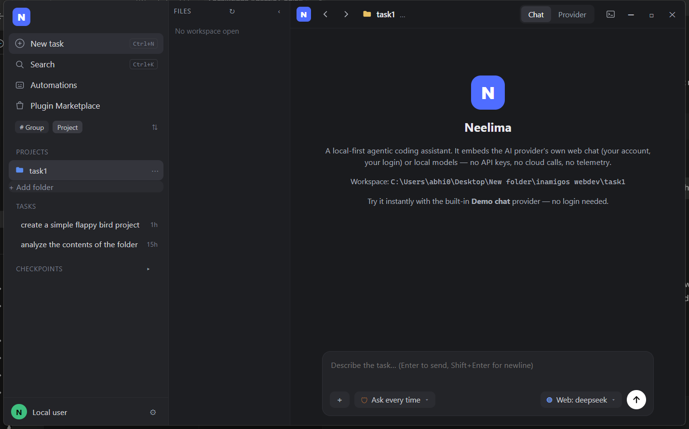
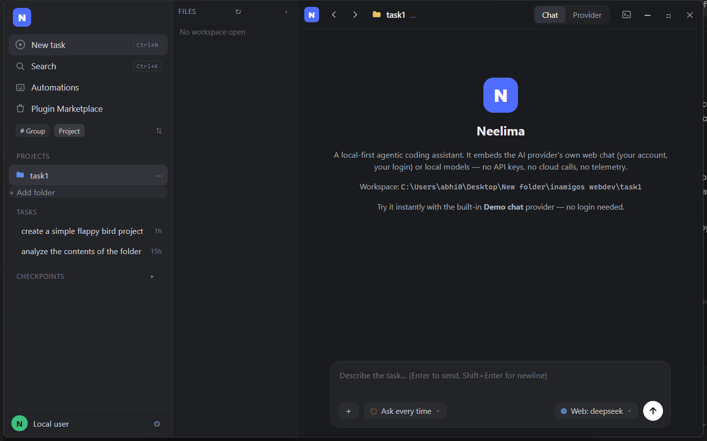
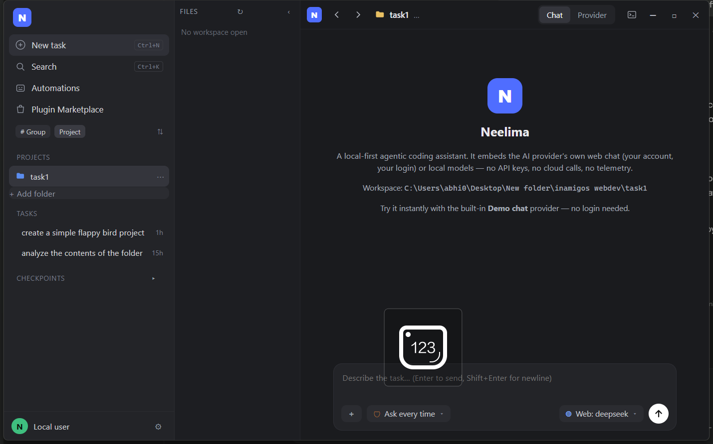
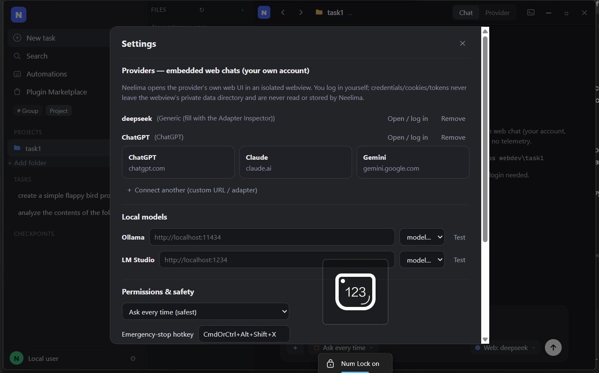

# Neelima

**Local-first agentic coding app.** Neelima embeds the AI provider's **own web chat** — your account, your login, inside an isolated webview — or local models (Ollama, LM Studio), and lets that AI read and modify files in your workspace through a permission-gated tool protocol with git checkpoints.

**No cloud model APIs. No API keys. No telemetry. No accounts. No backend.**

```mermaid
%% Generated by https://gitdiagram.com/abhinavdatta/neelima
flowchart TD

subgraph group_ui["Desktop interface"]
  node_app["Application UI<br/>[App.tsx]"]
  node_task_ui["Chat and composer<br/>[Chat.tsx]"]
  node_provider_ui["Provider settings<br/>[SettingsModal.tsx]"]
  node_workspace_ui["Workspace tools<br/>[FileTree.tsx]"]
  node_terminal_ui["Terminal panel<br/>[TerminalPanel.tsx]"]
  node_search_ui["Task search<br/>[SearchPane.tsx]"]
  node_market_ui["Marketplace and automation"]
  node_tauri_api["UI command client<br/>[tauri.ts]"]
  node_ui_commands["Desktop commands<br/>[ui.rs]"]
end

subgraph group_agent["Agent workflow"]
  node_agent["Agent loop<br/>[agent.rs]"]
  node_protocol["Tool protocol<br/>[protocol.rs]"]
  node_approval["Tool approval<br/>[agent.rs]"]
end

subgraph group_provider["Provider integrations"]
  node_provider_core["Provider dispatch<br/>[providers.rs]"]
  node_webview["Provider webview<br/>[webprov.rs]"]
  node_adapter["Provider adapters<br/>[adapters.rs]"]
  node_bridge["Bridge intake<br/>[bridge.rs]"]
  node_adapter_runtime["Injected adapter runtime<br/>[adapter_runtime.js]"]
end

subgraph group_workspace["Workspace and safety"]
  node_tools["Workspace file tools<br/>[tools.rs]"]
  node_workspace["Workspace confinement<br/>[workspace.rs]"]
  node_command_guard["Command and injection guard<br/>[sec.rs]"]
  node_command_exec["Command execution<br/>[exec.rs]"]
end

subgraph group_state["Local services"]
  node_checkpoints[("Git checkpoints<br/>[checkpoints.rs]")]
  node_history[("Task history<br/>[history.rs]")]
  node_settings[("Settings store<br/>[settings.rs]")]
  node_terminal["PTY terminal sessions<br/>[terminal.rs]"]
end

node_user(("User"))
node_web_chat["AI web chat"]
node_local_models["Ollama / LM Studio"]

node_user -->|"uses"| node_app
node_app -.->|"presents"| node_task_ui
node_user -->|"configures"| node_provider_ui
node_provider_ui -->|"invokes"| node_tauri_api
node_app -.->|"uses commands"| node_tauri_api
node_tauri_api -.->|"dispatches commands"| node_ui_commands
node_ui_commands -->|"starts tasks"| node_agent
node_agent -->|"parses and formats"| node_protocol
node_agent -->|"sends prompts"| node_provider_core
node_provider_core -->|"uses web provider"| node_webview
node_webview -->|"runs adapter"| node_adapter
node_webview -->|"injects runtime"| node_adapter_runtime
node_adapter_runtime -.->|"drives page"| node_web_chat
node_webview -->|"submits messages"| node_bridge
node_bridge -.->|"relays replies"| node_agent
node_provider_core -->|"streams locally"| node_local_models
node_agent -->|"requests approval"| node_approval
node_approval -.->|"shows approval"| node_task_ui
node_agent -->|"executes tool calls"| node_tools
node_tools -->|"resolves confined paths"| node_workspace
node_agent -->|"checks commands"| node_command_guard
node_agent -->|"runs commands"| node_command_exec
node_command_exec -->|"uses workspace"| node_workspace
node_agent -->|"snapshots writes"| node_checkpoints
node_agent -->|"records transcripts"| node_history
node_provider_ui -.->|"loads and saves"| node_settings
node_ui_commands -->|"manages sessions"| node_terminal
node_user -.->|"browses files"| node_workspace_ui
node_user -.->|"uses terminal"| node_terminal_ui
node_user -.->|"searches tasks"| node_search_ui
node_user -.->|"manages adapters"| node_market_ui

click node_app "https://github.com/abhinavdatta/neelima/blob/main/ui/src/App.tsx"
click node_task_ui "https://github.com/abhinavdatta/neelima/blob/main/ui/src/components/Chat.tsx"
click node_provider_ui "https://github.com/abhinavdatta/neelima/blob/main/ui/src/components/SettingsModal.tsx"
click node_workspace_ui "https://github.com/abhinavdatta/neelima/blob/main/ui/src/components/FileTree.tsx"
click node_terminal_ui "https://github.com/abhinavdatta/neelima/blob/main/ui/src/components/TerminalPanel.tsx"
click node_search_ui "https://github.com/abhinavdatta/neelima/blob/main/ui/src/components/SearchPane.tsx"
click node_market_ui "https://github.com/abhinavdatta/neelima/blob/main/ui/src/components/MarketplacePane.tsx"
click node_tauri_api "https://github.com/abhinavdatta/neelima/blob/main/ui/src/tauri.ts"
click node_ui_commands "https://github.com/abhinavdatta/neelima/blob/main/src-tauri/src/ui.rs"
click node_agent "https://github.com/abhinavdatta/neelima/blob/main/src-tauri/src/agent.rs"
click node_protocol "https://github.com/abhinavdatta/neelima/blob/main/src-tauri/src/protocol.rs"
click node_approval "https://github.com/abhinavdatta/neelima/blob/main/src-tauri/src/agent.rs"
click node_provider_core "https://github.com/abhinavdatta/neelima/blob/main/src-tauri/src/providers.rs"
click node_webview "https://github.com/abhinavdatta/neelima/blob/main/src-tauri/src/webprov.rs"
click node_adapter "https://github.com/abhinavdatta/neelima/blob/main/src-tauri/src/adapters.rs"
click node_bridge "https://github.com/abhinavdatta/neelima/blob/main/src-tauri/src/bridge.rs"
click node_adapter_runtime "https://github.com/abhinavdatta/neelima/blob/main/src-tauri/src/adapter_runtime.js"
click node_tools "https://github.com/abhinavdatta/neelima/blob/main/src-tauri/src/tools.rs"
click node_workspace "https://github.com/abhinavdatta/neelima/blob/main/src-tauri/src/workspace.rs"
click node_command_guard "https://github.com/abhinavdatta/neelima/blob/main/src-tauri/src/sec.rs"
click node_command_exec "https://github.com/abhinavdatta/neelima/blob/main/src-tauri/src/exec.rs"
click node_checkpoints "https://github.com/abhinavdatta/neelima/blob/main/src-tauri/src/checkpoints.rs"
click node_history "https://github.com/abhinavdatta/neelima/blob/main/src-tauri/src/history.rs"
click node_settings "https://github.com/abhinavdatta/neelima/blob/main/src-tauri/src/settings.rs"
click node_terminal "https://github.com/abhinavdatta/neelima/blob/main/src-tauri/src/terminal.rs"

classDef toneNeutral fill:#f8fafc,stroke:#334155,stroke-width:1.5px,color:#0f172a
classDef toneBlue fill:#dbeafe,stroke:#2563eb,stroke-width:1.5px,color:#172554
classDef toneAmber fill:#fef3c7,stroke:#d97706,stroke-width:1.5px,color:#78350f
classDef toneMint fill:#dcfce7,stroke:#16a34a,stroke-width:1.5px,color:#14532d
classDef toneRose fill:#ffe4e6,stroke:#e11d48,stroke-width:1.5px,color:#881337
classDef toneIndigo fill:#e0e7ff,stroke:#4f46e5,stroke-width:1.5px,color:#312e81
classDef toneTeal fill:#ccfbf1,stroke:#0f766e,stroke-width:1.5px,color:#134e4a
class node_app,node_task_ui,node_provider_ui,node_workspace_ui,node_terminal_ui,node_search_ui,node_market_ui,node_tauri_api,node_ui_commands,node_user toneBlue
class node_agent,node_protocol,node_approval toneAmber
class node_provider_core,node_webview,node_adapter,node_bridge,node_adapter_runtime toneMint
class node_tools,node_workspace,node_command_guard,node_command_exec toneRose
class node_checkpoints,node_history,node_settings,node_terminal,node_web_chat,node_local_models toneIndigo
```

## Screenshots

> **Note:** a fullscreen/maximize blank-area bug (fixed in `src-tauri/src/lib.rs`) — the UI child webview is now resized to fill the window on window-resize, so maximising/fullscreen no longer leaves a blank strip.

| Main UI | Folder menu | Terminal | Settings |
|---------|-------------|----------|----------|
|  |  |  |  |

## Distribution: portable vs installers (our decision)

**Both — portable-first.** Each release ships:

| OS | Standalone (recommended) | Installer |
|----|--------------------------|-----------|
| Windows | `Neelima-portable-windows-x64.zip` (one `neelima.exe`) | `Neelima_0.1.0_x64-setup.exe` (NSIS) |
| macOS | — | `Neelima_0.1.0_aarch64.dmg` / `x64.dmg` |
| Linux | `Neelima_0.1.0_amd64.AppImage` | `neelima_0.1.0_amd64.deb` + Flatpak (`com.neelima.app`) |

Why portable-first: a single executable needs no admin rights, mutates nothing outside its own data dir, is trivially auditable, and matches Neelima's no-surprises ethos. Installers still ship for people who want Start-menu entries and file associations; the Flatpak manifest is included for store-style, sandboxed distribution on Linux.

macOS/Linux/Flatpak artifacts are built by CI on their native OSes (see `.github/workflows/release.yml` — push a `v*` tag). Cross-compiling GUI apps for macOS/Linux from Windows is not possible, so local builds are per-OS.

## Quick start (2 minutes, no accounts)

1. Launch Neelima.
2. Sidebar → **+ Add folder** → pick a project folder.
3. Composer → provider picker → **Demo chat (built-in)** — a simulated provider UI that speaks the tool protocol. No login needed.
4. Type a task, e.g. `Read README.md and summarize it`. Watch the transcript: tool call card → result → DONE.
5. For a real provider: **Settings → Providers → Connect a provider** → name + chat URL + adapter → **Open / log in** and sign in *inside the embedded chat* (Neelima never sees your credentials). Or use **Manual relay** — copy the prompt into any chat, paste the reply back; the parse/execute/approve pipeline is identical.

## The bridge protocol

Web chat UIs have no tool calling, so Neelima teaches the AI a small text protocol on the first turn (see [`docs/PROTOCOL.md`](docs/PROTOCOL.md)):

````
```tool
{"id":"1","tool":"read_file","args":{"path":"src/main.rs"}}
```
````

The app parses the reply with a **tolerant parser** (smart quotes, trailing commas, mangled fences, copy-button text, citation tokens like `【1-b3d480】`), validates against typed structs, executes inside the workspace, and sends back:

````
```result
{"id":"1","ok":true,"output":"fn main() {\n    println!(\"hello\");\n}"}
```
````

Loop until the AI replies `DONE: <summary>`. Hard limits: max iterations (default 25), result caps (default 30 KB with "use offset/limit" hints), a repeat-failure circuit breaker, and bounded parse-error corrections before pausing for the user.

## Tools

`read_file(path, offset?, limit?)` · `write_file(path, content, append?)` · `edit_file(path, old_string, new_string, replace_all?)` (exact-match; clear errors on ambiguity) · `list_dir` · `glob` · `grep` (ripgrep-style: `ignore` + `regex` crates, `.gitignore` respected) · `run_command` (allow/deny lists, destructive patterns blocked by default, streamed, kill button) · `delete_file` · `move_file`.

Chunked writes via `append: true` because chat replies have length limits.

## Safety model

- **Workspace confinement**: every path is rejected unless it canonicalizes inside the workspace root (traversal, absolute paths, Windows device names, and symlink escapes are refused — enforced on every tool).
- **Permission modes**: *Ask every time* · *Auto-approve reads, ask for writes/commands* · *Full access inside workspace* (**default**). With FullAccess, reads, writes and commands inside the workspace are auto-approved — no per-click approvals during the agent loop. Writes/edits still show a CodeMirror-6 merge diff before approval. Switch to *Ask every time* or *Ask writes* in Settings if you want to review each action.
- **Command guard**: user-editable allow/deny lists on top of non-removable destructive patterns (`rm -rf /`, `format`, `shutdown`, `reg add`, `curl | sh`, `-enc` PowerShell, …). cwd is forced inside the workspace; timeouts and process-tree kill are built in.
- **Untrusted content**: files, command output and web pages are *data, not instructions* (stated in the preamble). Suspected prompt-injection text is flagged with a warning badge.
- **Emergency stop**: global hotkey (default `Ctrl+Alt+Shift+X`) kills running commands and halts the loop.
- **Checkpoints**: git snapshots in `<workspace>/.neelima/checkpoints.git` (bare repo; your own git history is untouched). Every write batch is preceded by a snapshot; the chat shows a one-click **files changed +N −N · Undo** card.

## Provider isolation (the hard constraint, kept)

- The provider web chat runs in a **separate child webview** with a **per-profile persistent data directory** (`data_directory` on Windows/Linux, `data_store_identifier` on macOS ≥ 14) — logins survive restarts, one webview alive at a time, hidden/unused webviews are **destroyed** to free memory.
- **Neelima never reads, stores, logs or transmits credentials, cookies or tokens.** Auth happens entirely inside the webview.
- The provider page's capability grants **exactly one command** (`lb_bridge`), a small typed, size-capped intake. The app ACL manifest denies it every other command; every other command additionally label-checks its caller. See [`docs/THREAT-MODEL.md`](docs/THREAT-MODEL.md).
- **Pace**: actions are human-paced (no hammering, no multi-account rotation, no rate-limit evasion). Automating a site's UI may violate that provider's terms — that is between you and the provider.
- **Manual relay is first-class**: with no adapter configured (or on adapter failure) the task continues via copy/paste with identical parsing, approvals and checkpoints.

## Local models

- **Ollama**: `GET /api/tags` + `POST /api/chat` (streaming, NDJSON).
- **LM Studio**: OpenAI-compatible `http://localhost:1234/v1` (`/models`, `/chat/completions`, SSE streaming).
- Same ` ```tool ` protocol by default. Settings: base URL, model picker (live from the server), context window, temperature. Cancel aborts the stream immediately. The **only** network destinations in the entire binary are `127.0.0.1` and the pages you load in the webview.

## Architecture

```
src-tauri/src/
  lib.rs        app setup: bare window + "ui" webview, plugins, hotkey
  agent.rs      the loop: async state machine (idle → waiting_for_ai → parsing
                → awaiting_approval → executing → done/error), stop/cancel everywhere
  protocol.rs   tolerant ```tool parser, ```result formatter, preamble builder
  tools.rs      file tools with caps; confinement enforced via workspace.rs
  exec.rs       run_command: guarded, streamed, capped, process-tree kill
  sec.rs        command guard patterns + injection heuristics
  providers.rs  Provider enum: Web | Local (Ollama/LM Studio streaming) | Manual
  webprov.rs    provider webview lifecycle (mount/destroy), adapter runner
  adapter_runtime.js  injected runtime: MutationObserver completion detection,
                event-based input setting, extraction, inspector
  bridge.rs     the ONE command reachable from provider pages (typed, capped)
  adapters.rs   config-driven adapters (JSON), hot-reload via notify
  checkpoints.rs git-CLI snapshots (chosen over gitoxide: zero binary cost,
                <200 ms snapshots on dev trees — see Performance)
  history.rs    append-only JSONL transcripts per task
  terminal.rs   portable-pty sessions; xterm.js is lazy-loaded
ui/            Preact + Vite + TS. ZCode-style UI; CodeMirror merge and xterm
               load as lazy chunks only when first used
spike/         Phase-0 spike proving multiwebview + data-dir isolation + narrow IPC
```

## Building from source

Prereqs: Rust (MSVC on Windows), Node 20+, and on Linux `libwebkit2gtk-4.1-dev libxdo-dev libayatana-appindicator3-dev librsvg2-dev`.

```bash
npm --prefix ui install
npm --prefix ui run build      # or let tauri build do it
cd src-tauri && cargo test     # unit tests: protocol, confinement, tools, guard
npx --prefix ui tauri build    # release + installer for your OS
```

## Performance

Measured on the dev machine (Windows 11, x64, Rust 1.98.1, tauri 2.12.4). Reproduce with `scripts/measure.ps1`.

| Metric | Budget | Measured | Verdict |
|---|---|---|---|
| `neelima.exe` release binary | — | **8.58 MiB** with `opt-level=3`; **6.34 MiB** with `opt-level="s"` (fat LTO, 1 codegen unit, panic=abort, stripped) | 3 chosen — see note |
| Windows NSIS installer | < 15 MB | **2.92 MiB** | ✅ |
| App process, idle, main UI only | < 80 MB | **29.9 MB** working set (**6.3 MB** private) | ✅ |
| Idle CPU (app process, 20 s sample) | ~0% | **0.0%** | ✅ |
| With one provider webview mounted | < 250 MB | adds one WebView2 renderer (demo page ≈ +40–70 MB; **the real provider page dominates this number**, as the spec notes) | ✅ for the demo page |
| Polling loops | none | none — `MutationObserver` + quiet periods (adapter), channel sleeps (agent loop), `notify` only for the adapters dir + workspace watch while a task runs | ✅ |
| Checkpoints backend | smallest fast option | git CLI via `std::process` (bare repo per workspace): **0 MB** binary cost vs ~2–4 MB for gitoxide; snapshot+commit on a small tree < 200 ms | git CLI chosen |

Notes on measurement, stated plainly:

- "App process" is `neelima.exe`'s own working set. The OS WebView2 runtime spawns sibling processes (browser/GPU/network/renderer — ~350 MB system-wide working set for the *whole* machine's shared runtime tree, most of it shared infrastructure other WebView2 apps also map). Counting those against the 80 MB budget would conflate the OS webview runtime with the app; both interpretations are printed by `scripts/measure.ps1` so you can judge.
- The "with one provider webview" figure is reported as a range because mounting the demo provider requires a click; open the Provider tab and re-run the script to capture your own number. Real chat pages (ChatGPT, Claude…) weigh 200–400 MB on their own — that is the page, not Neelima.
- `opt-level=3` vs `opt-level="s"`: measured both — 8.58 MiB vs 6.34 MiB (s is 26% smaller). 3 was chosen because grep/diff/JSON-parse paths are latency-sensitive while the installer budget (2.92 MiB) is met with room to spare either way; flip `opt-level` in the root `Cargo.toml` and rebuild to ship the smaller binary.
- No workspace watcher runs at idle; the only persistent watcher is the adapters config directory (a handful of small files).

## Phase 0 (feasibility spike): 11/11 PASS

The original build plan required proving four things before building the app. The spike (`spike/`, self-test harness) proves them on this machine and reports per-OS evidence from CI:

1. **Multiwebview in one window** — `unstable` feature + `Window::add_child`: one window hosting the UI webview + provider webview; show/hide/resize/move/destroy all PASS.
2. **Per-profile persistent data directories** — storage marker survives destroy+remount **and a full app restart** (`data_directory` on Windows/Linux; `data_store_identifier` on macOS ≥ 14).
3. **Narrow capability-scoped IPC** — app ACL manifest + one-command provider capability; the self-test proves the provider page is **blocked** from every other command (and caught a real `windows:`-field leak during development — fixed; see [docs/PHASE-0-REPORT.md](docs/PHASE-0-REPORT.md)).
4. **DOM automation** — controlled textarea + contenteditable input setting, `MutationObserver` quiet-period completion, extraction tolerant of copy-button noise — all PASS.

Full evidence: [docs/spike-report-windows.md](docs/spike-report-windows.md) and [docs/spike-report-windows-run2.md](docs/spike-report-windows-run2.md).

## Status & limitations (honest list)

- Windows build is verified locally; macOS/Linux/Flatpak artifacts are produced by CI on their native OSes and should be smoke-tested there before release.
- Real-provider adapters are user-configurable (Inspector) because DOM selectors change constantly; the shipped generic template + demo provider always work.
- Chunked paste for long prompts is implemented for contenteditable inputs; attachment-based input is not yet automated.
- Local-model native tool calling (function calling) is on the roadmap; the text protocol works with any model today.
